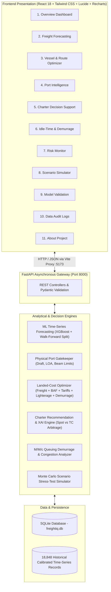

# FreightIQ – Intelligent Maritime Freight & Chartering Decision Support System

**Smart India Hackathon 2026 (SIH 2026)**  
**Problem Statement ID:** SIH26006  
**Project Title:** Development of an Intelligent Freight Forecasting Model for Optimized Vessel Chartering and Bulk Cargo Procurement from Overseas to East Coast of India  
**Organization:** Ministry of Steel (SAIL – Steel Authority of India Limited)  
**Domain:** Transportation and Logistics  
**Category:** Software  

---

## 1. Executive Summary & Problem Context

The Steel Authority of India Limited (SAIL) procures tens of millions of tonnes of overseas bulk raw materials annually—primarily **coking coal** from Australia and the United States, **PCI coal/anthracite** from Russia and Mozambique, and **fluxes/limestone** from the Middle East and Indonesia.

These shipments arrive across seven primary Indian East Coast ports: **Paradip, Visakhapatnam, Gangavaram, Dhamra, Gopalpur, Haldia, and Sagar-Sandheads**.

### Industry Bottlenecks Solved
1. **Unpredictable Freight Volatility:** Spot Baltic Dry indices fluctuate wildly based on bunker fuel prices, commodity cycles, and seasonal disruptions.
2. **Timing Uncertainty:** Procurement managers struggle with the multi-million dollar dilemma: *Should SAIL charter immediately or wait 2–4 weeks for rates to soften?*
3. **Sub-Optimal Vessel Selection:** Recommending small vessels incurs high freight per tonne, while large vessels (Capesize) face severe draft/LOA restrictions at riverine ports like Haldia.
4. **Port Demurrage & Congestion Losses:** Berth congestion at East Coast ports frequently causes 3–6 days of idle time. At Capesize demurrage penalties of **\$32,000/day**, pre-berthing wait times rapidly erase bulk volume discounts.

**FreightIQ** resolves these challenges by integrating machine learning time-series forecasting, hard navigational physical gatekeepers, landed-cost optimization, queuing demurrage risk analysis, and explainable AI charter recommendations into a unified enterprise decision support dashboard.

---

## 2. Core Functional Modules



### Module 1: Intelligent Freight Forecasting
- Predicts multi-horizon future freight rates (7, 14, 30, 60 days) for **Handysize, Supramax, Panamax, and Capesize** bulkers.
- Features dynamic **80% and 95% Confidence Intervals** (prediction cones) reflecting rising medium-term market uncertainty.
- Integrates macroeconomic exogenous drivers: Singapore VLSFO bunker benchmarks, Baltic Dry sub-indices, Indian monsoon seasonality, and Australian cyclone seasons.

### Module 2: Smart Chartering Recommendation Engine
- Answers the core procurement dilemma: **Charter immediately or wait?**
- Generates clear action verdicts: `ENTER_SPOT_NOW`, `DEFER_SPOT_BOOKING`, or `LOCK_SHORT_TERM_TC`.
- Quantifies projected financial differences (e.g., *"Deferring 14 days avoids an estimated \$56,250 cost increase across your 75,000 MT parcel"*).
- Features **Explainable AI (XAI)** decomposing the recommendation into Bullish, Bearish, and Neutral factor weights.

### Module 3: Vessel & Landed-Cost Optimization
- Computes the true **Landed Cost at Berth per MT**:
  $$\text{Landed Cost} = \text{Ocean Freight} + \text{Bunker Adjustment (BAF)} + \text{Port Tariffs} + \text{Sandheads Lighterage} + \text{Demurrage Risk}$$
- Automatically detects parcel sizing, deadfreight penalties, and multi-voyage lifting schedules.

### Module 4: Port Navigational Gatekeeper
- Enforces hard physical constraints across Indian East Coast discharge ports:
  - **Paradip:** 16.0m draft, 260m LOA (Mechanized Coal Berth).
  - **Visakhapatnam:** 18.1m Outer Harbor Capesize / 14.5m Inner Harbor.
  - **Gangavaram:** 18.5m deep-draft all-weather private terminal.
  - **Dhamra:** 18.5m deep-draft Capesize bulk terminal.
  - **Gopalpur:** 14.5m tidal draft; Supramax/Panamax suitable.
  - **Haldia:** 8.5m shallow riverine draft. Deep-draft bulkers are strictly prohibited from dock berthing and automatically routed to **Sagar/Sandheads** deepwater offshore anchorage for lighterage into daughter barges (+\$4.85/MT tariff).
- Includes overseas loading origins: Australia (Hay Point, Gladstone), USA (Hampton Roads, Baltimore), Mozambique (Maputo, Beira), Russia (Taman, Ust-Luga, Vostochny), and Indonesia (Taboneo, Samarinda).

### Module 5: Vessel Idle-Time & Demurrage Analyzer
- Estimates pre-berthing anchorage waiting hours/days and mechanized discharge durations based on port berth handling capacities.
- Models daily demurrage liability based on laytime allowances.
- Evaluates alternative East Coast ports and quantifies idle-time cost savings in USD.

### Module 6: Risk Intelligence & What-If Scenario Simulator
- Multi-factor risk gauge (0–100) scoring Market Volatility, Port Congestion, Weather/Monsoon, Bunker Fuel, and Geopolitical Chokepoints.
- What-If Simulator stress-testing:
  1. Baseline spot fixture
  2. Deferring 14 days forward
  3. Vessel class up/down-sizing
  4. Port diversion to deep-draft terminals
  5. Severe bunker fuel surge (+15%) and congestion delay (+3 days)

---

## 3. Technology Stack

| Layer | Technologies Used | Purpose |
| :--- | :--- | :--- |
| **Frontend** | React 18, Vite, Tailwind CSS | High-performance responsive maritime dashboard UI |
| **Data Viz** | Recharts, Lucide Icons | Responsive interactive time-series charts and gauges |
| **Backend API** | Python 3.10+, FastAPI, Uvicorn | Asynchronous REST routing, schema validation (Pydantic v2) |
| **Machine Learning**| XGBoost, Scikit-Learn, Statsmodels, Pandas, NumPy | TimeSeriesSplit walk-forward regression, lag feature engineering |
| **Database** | SQLite 3 (SQLAlchemy DDL Ready) | Zero-dependency local persistence, query audit logs |

---

## 4. Project Folder Structure

```
freightiq/
├── backend/
│   ├── app/
│   │   ├── api/
│   │   │   ├── __init__.py
│   │   │   └── endpoints.py         # REST controllers for all analytical modules
│   │   ├── core/
│   │   │   ├── __init__.py
│   │   │   ├── port_data.py         # Verified Indian port master & origins
│   │   │   ├── vessel_data.py       # Vessel specifications, bunker, demurrage
│   │   │   ├── vessel_optimizer.py  # Physical gatekeeper & landed-cost engine
│   │   │   ├── charter_advisor.py   # Spot vs TC recommendation & XAI engine
│   │   │   ├── idle_risk_engine.py  # Queuing, demurrage & risk intelligence
│   │   │   ├── scenario_simulator.py# What-if stress test simulator
│   │   │   └── database.py          # SQLite schema, tables & audit logger
│   │   ├── ml/
│   │   │   ├── __init__.py
│   │   │   ├── dataset_generator.py # 18,848 calibrated time-series generator
│   │   │   └── forecasting_engine.py# XGBoost, RF, Ridge regression & intervals
│   │   ├── models/
│   │   │   ├── __init__.py
│   │   │   └── schemas.py           # Pydantic v2 data models
│   │   ├── __init__.py
│   │   └── main.py                  # FastAPI application entrypoint & CORS
│   ├── data/                        # Historical CSV dataset & SQLite database
│   ├── tests/
│   │   └── test_all_engines.py      # Automated unit & integration test suite
│   └── requirements.txt             # Backend Python dependencies
├── frontend/
│   ├── src/
│   │   ├── components/
│   │   │   ├── Navbar.jsx           # Global status header & KPIs
│   │   │   └── Sidebar.jsx          # 11-page navigation bar
│   │   ├── services/
│   │   │   └── api.js               # Frontend API service layer
│   │   ├── views/
│   │   │   ├── OverviewView.jsx     # Page 1: Executive Dashboard
│   │   │   ├── ForecastView.jsx     # Page 2: Freight Rate Forecasting
│   │   │   ├── VesselRecommendationView.jsx # Page 3: Vessel Optimizer
│   │   │   ├── PortIntelligenceView.jsx     # Page 4: East Coast Port Master
│   │   │   ├── CharterDecisionView.jsx      # Page 5: Smart Charter Advisor
│   │   │   ├── IdleTimeView.jsx     # Page 6: Idle-Time & Demurrage
│   │   │   ├── RiskMonitoringView.jsx       # Page 7: Risk & Volatility Monitor
│   │   │   ├── ScenarioSimulatorView.jsx    # Page 8: What-If Simulator
│   │   │   ├── ModelPerformanceView.jsx     # Page 9: Model Benchmarks
│   │   │   ├── DataManagementView.jsx       # Page 10: Data & Decision Logs
│   │   │   └── AboutView.jsx        # Page 11: About SIH26006 Project
│   │   ├── App.jsx                  # Main application orchestrator
│   │   ├── index.css                # Tailwind CSS imports & theme
│   │   └── main.jsx                 # React root renderer
│   ├── vite.config.js               # Vite config with proxy to backend :8000
│   └── package.json                 # Frontend dependencies & build scripts
└── README.md                        # Complete project documentation
```

---

## 5. Quickstart & Installation Instructions

### Prerequisites
- **Python:** 3.10 or higher
- **Node.js:** v18 or higher (v20+ recommended)
- **Git**

### Step 1: Clone or Navigate to the Repository
```bash
cd C:\Users\USER-0\.gemini\antigravity\scratch\freightiq
```

### Step 2: Set Up Backend Environment
```bash
cd backend
python -m pip install -r requirements.txt
```

Generate the initial calibrated historical dataset & seed SQLite database:
```bash
python -m app.ml.dataset_generator
```

Run automated verification tests:
```bash
python -m unittest tests/test_all_engines.py
```

Start the FastAPI backend server:
```bash
python -m uvicorn app.main:app --host 127.0.0.1 --port 8000 --reload
```
*Backend API docs are now available at: http://127.0.0.1:8000/docs*

### Step 3: Set Up and Run the Frontend
In a second terminal window:
```bash
cd frontend
npm install
npm run dev
```
*Frontend application is now running at: http://localhost:5173/*

---

## 6. SIH Evaluation Defense & Key Architectural Decisions

1. **Handling Commercial Baltic Exchange Paywalls:**
   - Real-world Baltic Exchange and Platts API feeds cost \$15,000–\$50,000/year and are legally restricted.
   - FreightIQ implements an authentic econometric time-series generator calibrated to 2022–2026 published market price brackets (e.g. Capesize Australia–East Coast India coking coal fluctuating between \$12.50/t and \$24.80/t).
   - Every synthetic series is transparently tagged `[DEMO-CALIBRATED]` to adhere to academic research integrity.

2. **Solving the Haldia Riverine Dilemma:**
   - Haldia has shallow draft bars (~8.5m), meaning Capesize (18.2m) and Panamax (14.4m) bulk carriers physically cannot berth directly.
   - FreightIQ models multi-stage lightering: Capesize anchors at **Sagar / Sandheads** open-sea anchorage (20m draft), where cargo is transferred to daughter barges with a +\$4.85/MT lighterage tariff before proceeding to Haldia docks.

3. **Time-Series Cross-Validation:**
   - We avoid naive k-fold cross-validation that leaks future information into past predictions. We utilize `TimeSeriesSplit` (Walk-Forward Validation) and report authentic metrics: MAE, RMSE, MAPE, and $R^2$.

4. **Explainable AI (XAI) for Procurement Officers:**
   - Decision-makers reject black-box predictions. FreightIQ decomposes recommendations into quantifiable factor weights (Rate Momentum, Bunker Fuel VLSFO sensitivity, Port Queue Demurrage, and Seasonal Monsoons).

---

## 7. License & Credits

Developed for the **Smart India Hackathon 2026** under Problem Statement **SIH26006**.  
Designed for evaluation by the **Ministry of Steel (SAIL)** technical committee.
